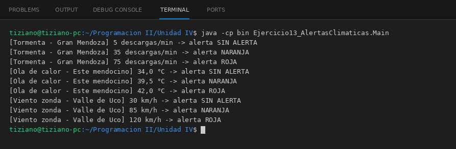

# AlertaClimatica

Programación II - Unidad 4 - Ejercicio 13

## Consigna
Emitir alertas meteorológicas con distintos umbrales según el fenómeno.

## Lógica
- Clase abstracta `AlertaClimatica` (zona) con `void emitirAdvertencia(double magnitudMedida)` y un método protegido `clasificar(...)` que devuelve SIN ALERTA, AMARILLA, NARANJA o ROJA según tres umbrales.
- `AlertaTormenta` (descargas/min), `AlertaCalor` (°C) y `AlertaViento` (km/h) usan umbrales propios.
- `SistemaMonitoreo.disparar(alerta, medicion)` acepta cualquier `AlertaClimatica`.
- `Main`: tres mediciones para cada fenómeno.

## Ejecución

